# Выгрузка ClickBench из ClickHouse: форматы, сжатие и цена декодирования

Эксперимент 6 октября 2026 года. **Parquet снова выиграл конечную выгрузку ClickBench в Rust**, но ArrowStream оказался дешевле по CPU источника и позволяет обрабатывать поток без полного файла. Противоречие с pandas-графиком Пети исчезает после разделения контрактов, буферизации и настроек клиента.

Завершены **208 performance-запусков, 179 разных профилей и 5 полных проверок значений**. Все **213 запусков** подтверждены серверным журналом: **2,222 завершённых data-запроса по 10 млн строк**. В полном CLI проверены **80 завершений pipeline с output_rows=10,000,000**. Финальных неуспешных или неподтверждённых ячеек нет; ранние ошибки сохранены в [FAILURES](FAILURES.md).

## Что измеряем

Источник — выделенный Managed ClickHouse **26.9.5.2-yc.1**, 32 vCPU / 128 GiB, хост в **vla**. Клиент — dev-сервер в vla, 32 логических CPU AMD EPYC 7713, около 47 GiB RAM. HTTPS и Native TCP используют проверку CA и имени хоста. Минимальный наблюдавшийся TCP RTT около 0.11 ms. Это измерение пути, а не доказательство отсутствия других сетевых ограничений.

Данные — **точный опубликованный Петей набор `cb_w105_10m`: 10,000,000 строк, 105 столбцов**, десять файлов `hits_compatible/athena_partitioned`. Это не прежняя таблица из 50 млн transfer-log строк и не первые 10 млн строк произвольного hits.csv. Проверены размеры файлов по манифесту, количество строк, контрольная сумма WatchID, суммы байтов Title/URL и временные границы. Три временных поля объявлены `DateTime('UTC')`. Таблица после загрузки не менялась, `ORDER BY tuple()`, ReplicatedMergeTree из-за требования Managed ClickHouse. [Манифест исходного эксперимента](https://storage.yandexcloud.net/between-sql-and-data-bench-files/manifest.json).

Основная матрица — проекции **10 / 50 / 105 столбцов**, `max_threads=16`, восемь Parquet-декодеров, row group 250,000. В первом проходе каждой ячейки — отдельный прогрев, затем повторяющиеся **полностью завершённые запросы минимум 120 секунд**. В диагностике, финальных подтверждениях и полном CLI набор уже прогрет; первый запрос входит в замер без дополнительного per-cell прогрева. Незавершённый файл Parquet не считается результатом. Причинные диагностические серии имеют минимум 60 секунд, финальные подтверждения — 120 секунд. Лучшие варианты повторяются независимо; фактическое n указано в таблицах. Разброс — наблюдавшийся min–max, не доверительный интервал.

Все основные timed-клиенты — **Rust release**, fat LTO, один codegen unit, target-cpu=native. Probe использует стандартный system allocator; настоящий CLI — глобальный MiMalloc. Поэтому разница probe/pipeline не изолирует один только overhead orchestration. Python только управляет процессами и строит отчёт. Контроли на официальном C++-клиенте и C/libcurl вынесены отдельно. Артефакты содержат настройки каждого запроса, версии, SQL-подтверждение результатов, расход CPU и память.

## Границы измерений

- **Raw HTTP**: сервер сериализует данные; клиент получает и выбрасывает чанки. Формат не декодируется, целый ответ в RAM не удерживается. Знаменатель подтверждён завершённым SQL-запросом.
- **Transport decode**: HTTP ArrowStream декодируется потоково в проверенные Arrow batches; Parquet сначала целиком принимается, затем row groups декодируются параллельно; Native использует производственную Rust-зависимость. Batches после обработки освобождаются. Полного DataFrame/Table нет.
- **Typed IPC finalist**: сохраняются binary string annotations и дополнительно восстанавливаются три явно обнаруженных UTC DateTime-поля. ClickHouse экспортирует их в IPC как UInt32 секунд без timezone; простое считывание Arrow batch не восстанавливает контракт источника.
- **Production source → discard**: полный конечный запуск Transferia, включая discovery, проверки схемы, pipeline, учёт памяти и завершение. Приёмник намеренно отбрасывает данные — тестируем извлечение, а не запись в другую БД.
- **C++ Native**: транспорт, декодирование и дополнительная локальная Native-сериализация в /dev/null. Это другой контракт, чем создание Arrow-массивов в Rust.

В таблицах `t` — запрошенный серверный `max_threads`, `d` — настройка максимума декодеров. `d` применяется к Parquet и параллельному IPC; обычный StreamReader и Rust Native не становятся многопоточными от этого поля. `max_threads` не ограничивает все задачи общего format pool. Сравнение учитывает фактически потраченное CPU, а отдельные контроли меняют оба бюджета.

**Строк/CPU-секунду** = обработанные строки / сумма user+system CPU всего клиентского процесса. Это эффективность затрат CPU, а не wall-throughput одного выделенного физического ядра. Среднее число занятых клиентских ядер = CPU-seconds / wall-seconds. CPU источника — отдельно из завершённых data SELECT в `system.query_log`, без стоимости коротких discovery/health запросов; его peak memory — память запроса, не RSS всего CH-хоста. Baseline RSS семплируется каждые 0.5 s и может пропустить короткий пик; поздние серии используют kernel maxrss. Не смешиваем wire bytes с размером Arrow-массивов.

## Почему старые результаты и слайд 73 не обязаны совпадать

На слайде 73 — материализация **pandas**, без кодека: ArrowStream **35.613 s**, Parquet **44.407 s**. В других независимых ячейках Пети: raw **24.481 / 18.363 s**, Arrow Table **11.129 / 21.844 s**. Вычитать эти числа как время стадий одного запроса нельзя. Его клиент сохраняет целый объект, наш data plane потребляет ограниченные batches. Его CH — 26.7.5.10 на 16 CPU, клиент — 128 GB RAM; здесь CH — 26.9 на 32 CPU, Rust-клиент около 47 GiB. [Код и результаты Пети](https://github.com/petergurinov/between-sql-and-data).

Есть и конкретная разница доставки: `clickhouse-connect 0.8.9 raw_query` использует `wait_end_of_query=1` и сохраняет полный bytes-ответ; streaming-вызов отключает это ожидание. У нас raw потоковый, а server-wait проверяется отдельным контролем. Это различие контрактов, а не доказательство, что один формат универсально быстрее. [Точный исходник драйвера](https://github.com/ClickHouse/clickhouse-connect/blob/v0.8.9/clickhouse_connect/driver/httpclient.py).

Прежний внутренний отчёт 28 августа использовал **50 млн transfer-log строк**, а публичный ClickBench-тест 3 сентября — **2 млн строк локально на CH 25.8** и второй проход Speedtest. Поэтому эффект только зоны доступности или только версии сервера по этим отчётам выделить невозможно. См. [исторический артефакт](provenance/previous-transfer-log-report.md) и [заметки об исходниках](SOURCE-NOTES.md).

## Кодеки и скрытые отличия

Arrow IPC действительно поддерживает сжатие: **LZ4 frame и ZSTD**, независимые буферы. Arrow ZSTD использует level 1, Native здесь тоже level 1; Parquet по умолчанию level 3. Есть отдельный Parquet level-1 контроль. HTTP-компрессия — дополнительный внешний слой, а не форматный кодек. HTTP LZ4 default level 3 выбирает HC; отдельно проверен fast level 0. Одинаковое имя семейства не означает одинаковый encoder, framing или цену CPU. [Исходники точного upstream тега](https://github.com/ClickHouse/ClickHouse/tree/v26.9.5.2-stable).

**Parquet `none` всё ещё использует dictionary/RLE/page encodings**. Отсутствие кодека не делает его сырым Arrow-представлением. Проверяется отключение dictionary и размер row group. Для IPC проверяются binary strings, независимое параллельное декодирование, размер record batch, бюджеты потоков и одинаковые block settings. Параллельный IPC probe поддерживает именно dictionary-free fixture, проверяет каждый batch, но не является уже внедрённым упорядоченным production source.

Rust Native-клиент объявляет revision **54451**; реальный managed-сервер в TLS Hello объявляет **54492**. Новые C++-клиенты умеют дополнительные Native-представления; 26.9 добавляет отдельный поток накопительных offsets для String, недоступный старому revision. Сравнение C++ 26.7 и 26.9 на одном новом сервере проверяет эффект клиента/negotiation, не эффект обновления сервера. Без реализации новых packet/serialization форматов поднимать Rust revision нельзя. Языку программирования всю разницу приписывать нельзя. Подробности — [SOURCE-NOTES](SOURCE-NOTES.md).

## Что подтвердили измерения

В исходной матрице с 16 серверными потоками Parquet ZSTD даёт **2.81 / 2.27 / 1.69 млн строк/с** на 10 / 50 / 105 столбцах. Для 105 столбцов последовательный ArrowStream ZSTD даёт **0.922 млн**, текущий Rust Native LZ4 — **0.490 млн**. Это wire-decoding, а не ещё один pandas-бенчмарк. Значения — медианы двух независимых запусков соответствующих профилей. [Полная таблица](TABLES.md).

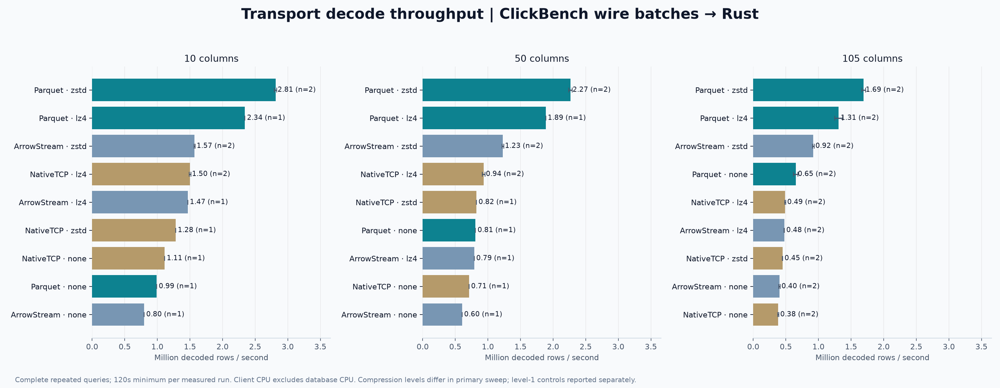

После настройки параллельного IPC, отключения маленького preferred-block target и явного восстановления UTC ArrowStream ZSTD достигает **1.202 млн строк/с** в двух независимых подтверждениях. У стандартного binary Parquet ZSTD с row group 250k — **1.579 млн**, n=3. Разрыв уменьшился: это примерно 31%, а не преимущество в несколько раз. Уменьшение Parquet row group до **62,500** подтвердилось: **1.897 млн строк/с**, n=2, диапазон **1.875–1.918 млн**. Это лучший подтверждённый decoded-профиль здесь; его отличие от настроенного ArrowStream составляет около **58%**. Сравнивать его с исходными настройками как один и тот же профиль нельзя.

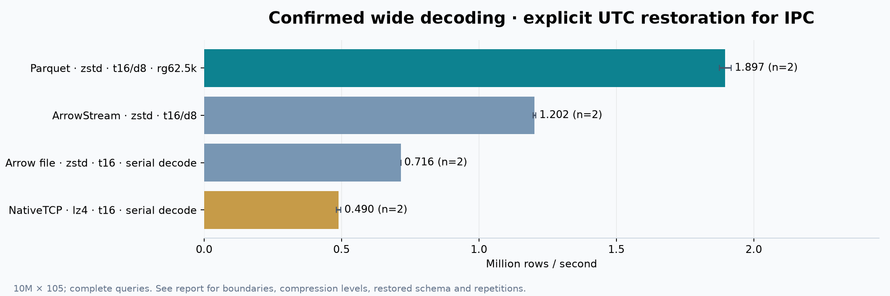

Production Parquet дополнительно отключает запись page index и Bloom filter: для полного сканирования они не используются. Probe оставляет серверные defaults. Production SQL также содержит проверки drift типов для всех 105 столбцов, которых нет в простом SELECT probe; запросы сохранены в query-log. Два дополнительных controls воспроизводят эти настройки: Parquet ZSTD — **1.636 млн**, LZ4 — **1.477 млн строк/с**, оба n=1 и ≥120 s. CPU источника на запрос — примерно **61 / 52 s** против **73 / 63 s** в стандартных binary-профилях. Эти flags уменьшают работу writer, но не объясняют все различия полного CLI. Поэтому совпадающие codec/t/d/row-group ещё не доказывают идентичный запрос.

Цена скорости различается. Для стандартного binary Parquet — около **73 CPU-секунд источника на 10 млн строк**, для tuned ArrowStream — **27 CPU-секунд**. Parquet занимает около **1.85 GiB client RSS**, tuned ArrowStream — **0.45 GiB**; обычный последовательный IPC существенно экономнее по памяти. У tuned ArrowStream эффективность клиента **0.811 млн строк/client CPU-с**, у стандартного binary Parquet **0.752 млн**. Быстрее завершить выгрузку и дешевле для источника — разные цели.

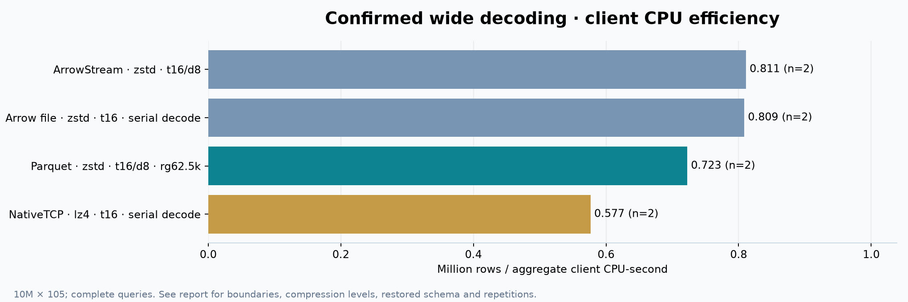

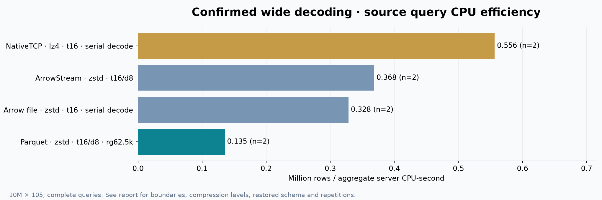

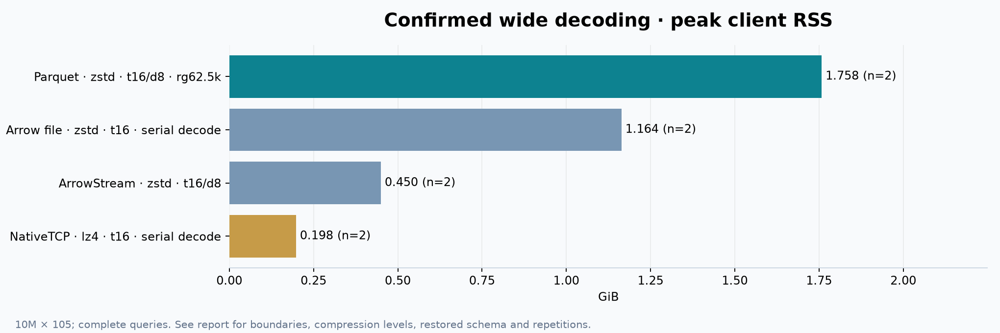

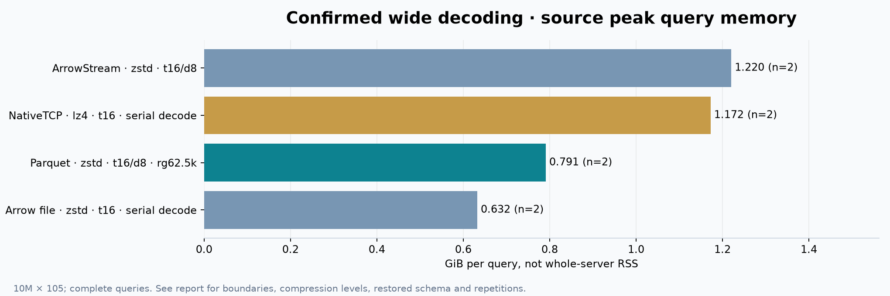

## Настоящий Transferia source → discard

Все шесть профилей используют свежий release-бинарь с исправленным LZ4 negotiation. Они включают discovery, SQL/schema guards, чтение, создание Arrow datasets, memory accounting, pipeline и завершение. n=1 — один непрерывный запуск не менее 120 s, внутри него несколько полных CLI-переносов. У каждого переноса новая delivery identity; resume не сокращает работу.

| Reader | Codec | Row group | Строк/с | Строк/client CPU-с | Peak client RSS | CPU источника на 10M |
|---|---|---:|---:|---:|---:|---:|
| Parquet | ZSTD | 62,500 | **1,761,597** | 816,563 | 3.24 GiB | 84.8 s |
| Parquet | LZ4 | 250,000 | **1,709,125** | 872,831 | 4.13 GiB | 72.2 s |
| Parquet | ZSTD | 250,000 | **1,649,985** | 787,139 | 4.28 GiB | 84.3 s |
| Native | LZ4 | — | **440,087** | 500,742 | 0.43 GiB | 19.6 s |
| Native | ZSTD | — | **419,201** | 498,402 | 0.45 GiB | 23.3 s |
| Native | none | — | **341,000** | 450,836 | 0.43 GiB | 13.8 s |

Parquet ZSTD/62.5k здесь быстрее ZSTD/250k примерно на 6.8% и занимает меньше памяти. LZ4/250k близок по скорости к ZSTD/62.5k — разница около 3.1%; одного независимого production-запуска недостаточно, чтобы назвать такую разницу универсальным преимуществом. LZ4 экономнее по CPU, ZSTD уменьшает объём ответа. Production RSS заметно больше, чем у count-only probe: нельзя использовать 1.8 GiB probe как обещание памяти всего pipeline.

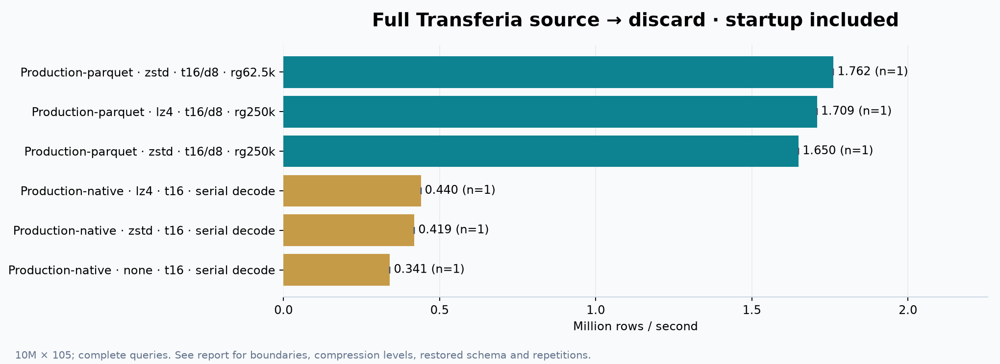

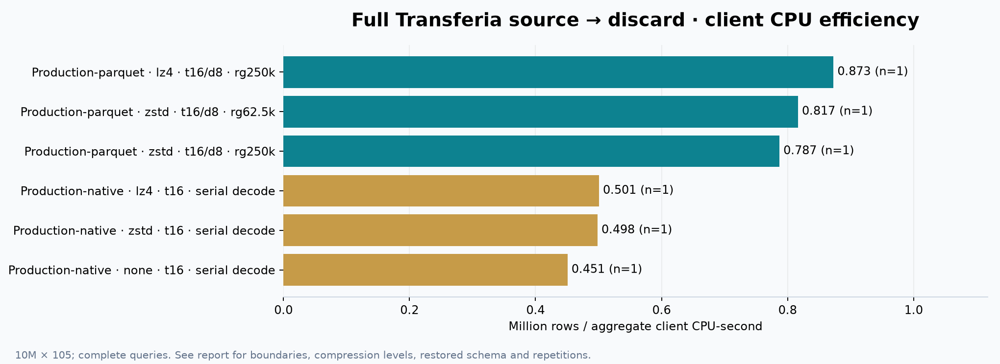

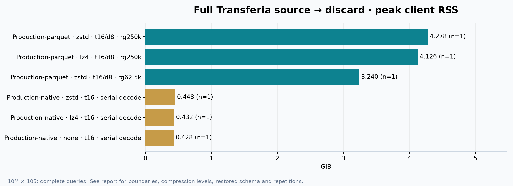

## Настройки, которые действительно меняют результат

- **Сжатие нужно проверять, а не предполагать.** У 105-колоночного Parquet стандартный ZSTD: 1.69 млн строк/с, LZ4: 1.31 млн, none: 0.652 млн. ArrowStream ZSTD: 0.922 млн, LZ4: 0.475 млн, none: 0.401 млн. Parquet gzip/Snappy/Brotli тоже проверены, но их дополнительные wide-профили имеют n=1 и не объявляются независимыми подтверждёнными победителями.
- **Одинаковый ZSTD level 1 не устранил преимущество Parquet.** В wide wire-decoding контроле он дал 1.402 млн строк/с, стандартный последовательный ArrowStream с тем же уровнем — 0.922 млн. Parquet-контроль n=1; это сравнение семейства/уровня при различающейся организации декодеров, не доказательство идентичной работы.
- **Уровень HTTP LZ4 оказался критическим.** Raw ArrowStream с внешним LZ4: default HC level 3 — 0.176 млн, fast level 0 — 0.703 млн строк/с. Parquet без внутреннего кодека с внешним LZ4: 0.192 → 0.892 млн. Нельзя переносить вывод «LZ4 медленный» между этими настройками. Контрольные level-0 ячейки — n=1, минимум 60 s.
- **Словари: ранний выигрыш не подтвердился.** Binary Parquet ZSTD без словарей сначала показал 1.941 млн, но после дополнительных повторов медиана n=4 — **1.556 млн**, диапазон **1.450–1.941 млн**. Стандартный профиль n=3 — 1.579 млн с гораздо меньшим разбросом. Без ZSTD отключение словарей увеличило ответ примерно с 3.9 до 7.6 GiB. Эта настройка не рекомендуется как доказанное ускорение.
- **Потоки имеют предел отдачи.** Binary Parquet ZSTD, t16: d1 / d4 / d8 / d16 — примерно 0.820 / 1.402 / 1.579 / 1.533 млн строк/с. t8 / t16 / t32 при d8 — 1.197 / 1.579 / 1.526 млн. Все изменённые бюджеты здесь диагностические n=1; вывод — основание оставить t16/d8, а не статистическое доказательство точного глобального оптимума.
- **Большой batch не гарантирует выигрыш.** Arrow record batch 250k не стал победителем. Parquet row group 1M также оказался медленнее 250k; 62.5k подтверждён независимым повторением. Arrow file проигрывает ArrowStream: его сначала нужно принять целиком, затем последовательный FileReader выполняет декодирование без перекрытия стадий.

Raw-матрица дополнительно содержит CSVWithNames, JSONEachRow, RowBinaryWithNamesAndTypes, HTTP Native, ORC, Arrow file, форматное и внешнее HTTP-сжатие. Для ORC проверены none/LZ4/ZSTD/Snappy/zlib. Эти raw-профили не имеют искусственно приписанной скорости декодирования в Arrow.

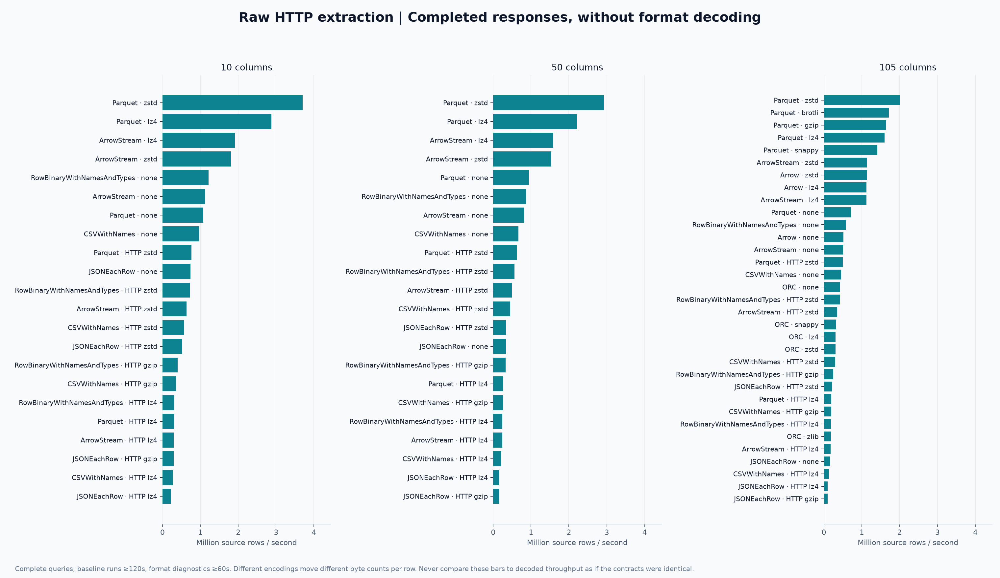

## Проверка серверной буферизации

У несжатого ArrowStream `wait_end_of_query=0 / 1`: **0.526 / 0.331 млн строк/с**. Медианное время до заголовков: **0.03 / 13.61 s**. У Parquet none: **0.731 / 0.449 млн**, заголовки **0.21 / 10.57 s**. Это примерно **37% / 39%** падения скорости в отдельных диагностических сериях n=1.

Серверный журнал подтверждает механизм: при streaming — **0 байт file writes** и 0 временных файлов; при ожидании — примерно **1,688 / 1,492 MiB записей в файлы на запрос** соответственно. File reads тоже растут на величину временного ответа. Это не вывод по одной задержке: он согласован с устройством HTTPHandler и наблюдаемыми счётчиками. Серверная буферизация добавляет работу и убирает перекрытие генерации с доставкой. Она объясняет конкретное различие контрактов Пети и нашего raw-пути, но не доказывает полную причину его pandas-результата.

## Контроли быстрых клиентов

C/libcurl получает несжатый ArrowStream со скоростью **1.154 млн**, Parquet — **1.440 млн строк/с**, около 21 MiB RSS. У Rust raw-probe соответствующие медианы — 0.510 / 0.716 млн, n=2. Здесь есть существенное ограничение клиентского HTTP/TLS-тракта; это не измеренный сетевой предел и не доказанная стоимость одного конкретного Rust вызова. В соответствии с задачей быстрый C-контроль включён отдельно; подменять им рейтинг Rust-декодеров нельзя.

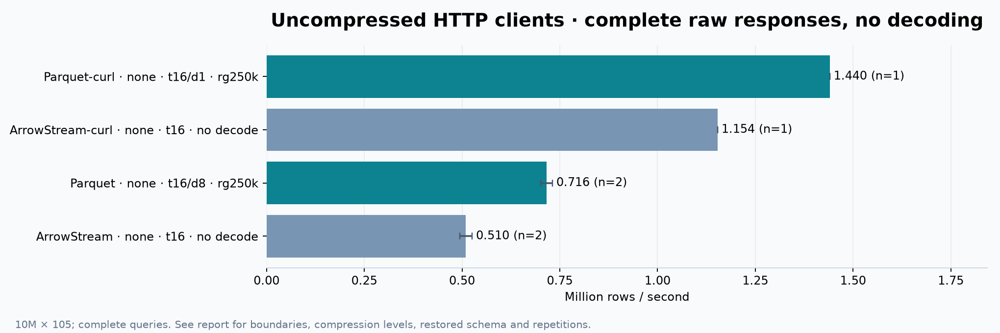

Официальный C++ Native клиент 26.7 / 26.9 на **одном текущем сервере**: none — **1.201 / 1.052 млн**, LZ4 — **1.042 / 0.954 млн**, ZSTD — **0.781 / 0.706 млн строк/с**. Все шесть ячеек — n=1, минимум 120 s. Новые возможности протокола здесь не дали автоматического ускорения. C++ пишет Native в /dev/null, Rust строит Arrow; различаются и negotiation, и представление данных, и работа клиента. Медленный Rust Native путь не доказывает медленный Native протокол.

`NetworkSendBytes` подтверждает разницу представления при negotiation (MiB на один 10M-запрос):

| Native codec | Rust 54451 | C++ 26.7 | C++ 26.9 | Изменение C++ 26.9 к 26.7 |
|---|---:|---:|---:|---:|
| none | 5,821 | 5,073 | 5,877 | +16% |
| LZ4 | 1,329 | 1,319 | 1,685 | +28% |
| ZSTD level 1 | 947 | 944 | 1,031 | +9% |

У сжатых Rust и C++ 26.7 объёмы практически одинаковы, но скорость отличается примерно вдвое: объяснить это одной сетью нельзя. Стоимость клиента и построения Arrow остаётся существенным фактором.

Увеличенный объём — измеренный вклад в отличие, но не отдельное доказательство, что вся разница вызвана только новым String offset stream. Negotiation включает несколько возможностей; контролируемого отключения каждой из них не было.

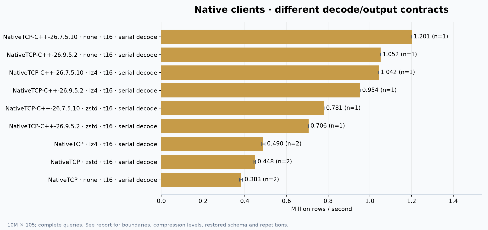

## Обнаруженная ошибка production-клиента

Новый сервер по умолчанию выбирает `network_compression_method=zstd`. Производственная зависимость явно согласовывала метод только для ZSTD; при выбранном LZ4 наследовала профиль сервера и затем отклоняла ZSTD frame: `Unexpected compression algorithm for LZ4: 90`. Ошибка проявилась уже на health check, в том числе перед Parquet snapshot, который использует Native для discovery.

Исправлена одна общая граница: `ClientMetadata::compression_settings` теперь явно отправляет **lz4** при выбранном LZ4. ZSTD и None сохраняют прежнюю семантику. TLS и revision не ослаблены, пользовательские данные не преобразуются. Production-бинарь пересобран после этого исправления, его результаты публикуются отдельно от probe.

Compile-only `just check-affected` после исправления прошёл за **9.62 s**. Две focused regression проверки прошли; возврат старой ветки LZ4 делает одну красной. Vendored crate не является workspace member, а его старые upstream unit-модули имеют посторонние ошибки компиляции. Поэтому использован временный изолированный harness: production-код неизменён, старые test-модули отключены только в копии, включены две новые проверки. Это не прохождение всей upstream suite. [Harness](../../../benchmarks/clickhouse_read_throughput/native_regression.py), [положительный запуск](provenance/native-regression-test.log), [старое поведение](provenance/native-regression-old.log).

## Практический выбор

Для такого конечного wide snapshot, если полный сжатый файл помещается в заданный memory budget, разумная стартовая настройка текущего Transferia — **Parquet, t16/d8, row group 62,500, ZSTD**. Для меньшей цены CPU и достаточной сети — **Parquet LZ4**, тоже с измерением на своей таблице. Отключённые page index/Bloom filter в production уже соответствуют полному сканированию.

Если важны обработка до конца ответа или небольшой объём памяти, потоковая модель предпочтительнее полного Parquet-файла. **ArrowStream ZSTD + checked parallel decode** — перспективный следующий production reader: 1.202 млн строк/с при меньшей цене CPU источника. Сейчас это benchmark-утилита: она ограничена dictionary-free fixture и восстанавливает три явно обнаруженных UTC поля; общего production Arrow reader этот эксперимент не добавляет. Текущий Native работает после исправления, но его клиентский тракт стоит оптимизировать; официальные C++ контроли показывают, что протокол умеет быстрее.

Не рекомендую выключать словари по первому удачному результату, увеличивать до 32 серверных/16 decoder потоков без измерения, включать HTTP LZ4 HC для throughput или поднимать Native revision без реализации соответствующих wire-layouts.

## Границы выводов

Это горячая неизменяемая таблица **10M × 105**, её проекции и одна конкретная сеть/пара машин. Нет cold-cache серии, WAN-контроля, контролируемого обновления только сервера, retained pandas/table, всех типов ClickHouse или null-heavy/Decimal/large-binary корпусов. CSV/JSON/RowBinary/ORC/HTTP Native измерены как raw delivery, не как внедрённые Arrow readers. Проверки значений покрывают все строки для выбранных fingerprints и временных полей, но не являются математическим доказательством каждого значения всех 105 столбцов.

Большинство диагностических ячеек имеет n=1; подтверждённые finalists — n≥2. Разброс между запусками и внутри одного запроса хранится в JSON/CSV; whiskers — observed run min–max, не confidence interval. Seconds/run показывает, где объединены 60s диагностика и 120s подтверждение. По одному fixture нельзя доказать глобальный оптимум на годы вперёд.

Wire объёмы — HTTP body bytes или server NetworkSendBytes на транспортной границе, а не packet capture с полным Ethernet/TLS overhead. CPU источника включает data SELECT, не весь managed-хост. C++/curl, system-allocator probe и MiMalloc production имеют разные клиентские контракты и показаны раздельно.

Полная матрица семейств и уровней покрыта сохранёнными schedules и [TABLES](TABLES.md); это не полный перебор каждой возможности ClickHouse, например Flight, каждой HTTP-кодировки или legacy Native layout. Все обязательные первичные профили проверены со сжатием и без, для каждого исследованного семейства — несколько поддерживаемых вариантов.

## Воспроизводимость

[Протокол](PROTOCOL.md), [журнал работ](WORKLOG.md), [проверка входных данных](input-integrity.json), [окружение](environment.json), [выбранные reference-ячейки](reference-cells.json), [сценарии](../../../benchmarks/clickhouse_read_throughput/README.md).

Секреты находятся только в приватных файлах на сервере и в репозиторий не входят. Ветка эксперимента добавляет benchmark-утилиты, отчёт и описанное выше исправление согласования LZ4 в vendored Native-клиенте с регрессионными проверками.
